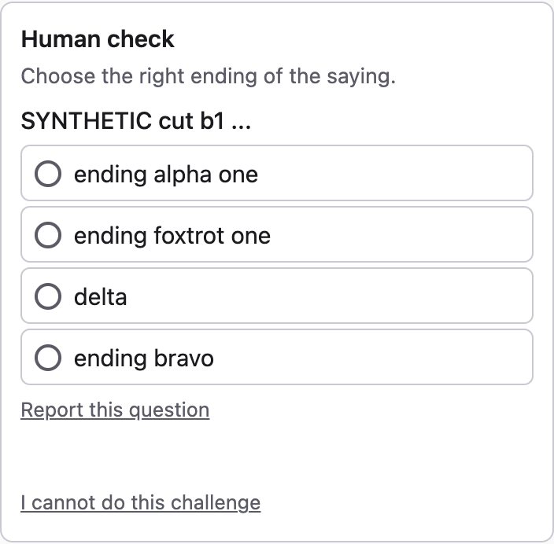
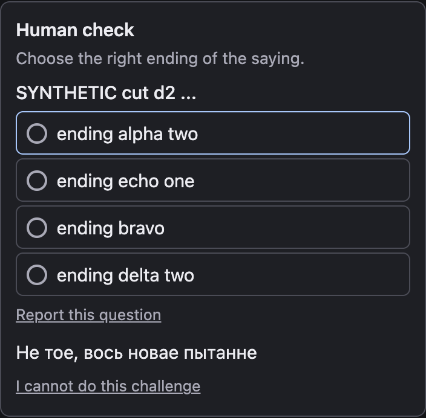
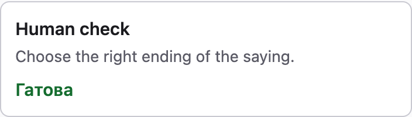
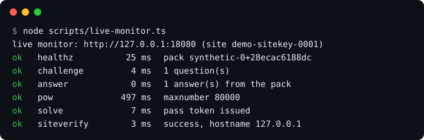

# belarusian-captcha

A self-hosted CAPTCHA in Belarusian that you run yourself, for web sites whose visitors read Belarusian and that do not want to send them to Google or another third party.

**Капча па-беларуску:** дакончы прыказку, перапішы слова, выберы малюнак.



The picture is the real widget, taken in a browser against a local server. The question text, "SYNTHETIC cut b1 ...", is placeholder data: the repository holds no reviewed Belarusian proverbs yet. The Belarusian on screen today is the three status messages, such as "Гатова" ("Done"); every other label is English until a native speaker writes and reviews it.

| A wrong answer: a new question | A right answer |
| --- | --- |
|  |  |

## What it is

- A widget (vanilla TypeScript, 6.2 kB gzipped, Shadow DOM) that asks the visitor to finish a proverb, behind an invisible SHA-256 proof-of-work check that gets harder when a client sends many requests.
- A verify API (Node, SQLite) that seals the challenges, checks the answer and issues a one-time pass token.
- A `siteverify` call that your backend makes with its secret, through the Node or Python SDK or plain HTTP.
- No cookies, no fingerprinting, no third-party requests, and no IP addresses stored.

Status: **phase 1 in progress**. The shared protocol library, the verify API server, its Docker
image, the browser widget and the Node and Python SDKs exist; reviewed content does not yet. Only
the proverb question type is built; the typed-word and picture types are planned. Nothing is released: the npm and PyPI packages are not published,
and the Docker image is built from this repository. The design is in
[`docs/DESIGN.md`](docs/DESIGN.md).

## Demo: one full pass, from the terminal

This runs the repository's live monitor against a local server. It acts like a visitor and a site:
it asks for a challenge, answers it from the synthetic content pack, solves the proof-of-work, gets a
pass token and verifies it with the site secret. Output as it was printed:



```text
$ node scripts/live-monitor.ts
live monitor: http://127.0.0.1:18080 (site demo-sitekey-0001)
ok    healthz        25 ms  pack synthetic-0+28ecac6188dc
ok    challenge       4 ms  1 question(s)
ok    answer          0 ms  1 answer(s) from the pack
ok    pow           497 ms  maxnumber 80000
ok    solve           7 ms  pass token issued
ok    siteverify      3 ms  success, hostname 127.0.0.1
```

This capture is from a run against a server on port 18080 with the compose demo site. To run it against the server from the quick start below, pass the site key and secret that `site add` printed:

```bash
BC_LIVE_URL=http://127.0.0.1:8080 BC_MONITOR_SITEKEY=<site key> BC_MONITOR_SECRET=<secret> \
  BC_MONITOR_ORIGIN=http://localhost:4173 node scripts/live-monitor.ts
```

The timings differ from run to run. The monitor is described in [Live monitor](#live-monitor).

## Quick start: see the widget in your browser

You need Node 24 (see `.nvmrc`) and a clone of this repository. These commands start a local API and the demo page; the key, site and database files they make are git-ignored:

```bash
npm ci && npm run build && npm run build:demo
node server/dist/admin.js keys init --keys keys.json
node server/dist/admin.js site add --sites sites.yaml --host localhost:4173   # prints a site key and a secret once
BC_HOST=127.0.0.1 BC_SITES=sites.yaml BC_KEYS_FILE=keys.json \
  BC_PACK=server/test/fixtures/synthetic-pack.json BC_STORE=sqlite:bc.sqlite \
  node server/dist/main.js &                                                          # API on http://127.0.0.1:8080
node demo/serve.mjs                                                                   # demo page on http://localhost:4173
```

Then open `http://localhost:4173/?api=http://localhost:8080&sitekey=<the site key>`. The page says
"API: Connected to http://localhost:8080." and the widget shows a question with four answers.
To see it with a backend that checks the token, use `docker compose up --build` instead
([below](#try-it-docker-compose-up)). To protect your own form, read
[`docs/INTEGRATION.md`](docs/INTEGRATION.md).

## When to use it, and when not

Use it when:

- your site is in Belarusian, or your readers are, and a Belarusian question is part of the point;
- you want to host the check yourself and keep visitor data on your own server;
- you want the cost of abuse to rise for scripts, and can treat a pass as one signal among several.

Do not use it when:

- you need protection against a determined attacker. A multimodal model that knows Belarusian
  proverbs, a paid solving farm or a patient bot on many addresses can pass it; a blind guess
  passes one question 25 % of the time. See [`docs/THREAT-MODEL.md`](docs/THREAT-MODEL.md);
- you need a ready-to-install package today: nothing is published yet;
- your visitors do not read Belarusian. An accessible way through exists (`GET /api/v1/fallback`: proof-of-work only, a low-score pass), but the question itself is a Belarusian proverb.

## FAQ

### How is it different from reCAPTCHA, hCaptcha or Turnstile?

Those are hosted services: the visitor's browser calls the provider. Here you run the verify API, the widget makes no third-party requests, and there are no cookies. In exchange you get no provider-side risk scoring and no large pool of challenges: the content is one pack of proverbs.

### How is it different from ALTCHA?

The proof-of-work is ALTCHA-compatible SHA-256. On top of it this project asks a Belarusian question and has a site-and-secret model with one-time pass tokens. ALTCHA is a general proof-of-work captcha with no language-specific content.

### Does it send my visitors' data anywhere?

Not to a third party. The widget calls only the API you give it. The API does not store IP addresses (the rate-limit bucket is an HMAC under a random in-memory key that changes at UTC midnight), its logs carry no IP, user agent, query or body, and a report records only the content item id. Details: [`docs/THREAT-MODEL.md`](docs/THREAT-MODEL.md#privacy).

### Does it work for screen reader users?

The proverb question is plain text with the roles and live region a screen reader needs, and a keyboard works throughout. The "I cannot do this challenge" button gives a proof-of-work-only pass marked `fallback: true` with a low score; your backend decides what to allow. Details: [`widget/README.md`](widget/README.md#accessibility).

### Is it free?

Code is Apache-2.0 and content is CC BY-SA 4.0 ([Licence](#licence)).

### How do I add it to my form?

Put `<div class="belarusian-captcha" data-sitekey="...">` and the widget script in the form, then check the `bc-response` field on your backend with `siteverify`. Step by step, for Node, Python, PHP and plain HTTP: [`docs/INTEGRATION.md`](docs/INTEGRATION.md).

### Why do I see English text and "SYNTHETIC" questions?

The repository's content is synthetic test data, and only three interface strings are in Belarusian so far. Reviewed proverbs and the rest of the translation wait for native-speaker review.

To add the captcha to a site, read [`docs/INTEGRATION.md`](docs/INTEGRATION.md) (widget, Node,
Python, plain PHP, any language over HTTP). The wire format is in
[`docs/PROTOCOL.md`](docs/PROTOCOL.md); what it stops and what it does not is in
[`docs/THREAT-MODEL.md`](docs/THREAT-MODEL.md).

| Package | What it is |
| --- | --- |
| [`shared/`](shared) | ALTCHA-compatible SHA-256 proof-of-work, sealed challenges, pass tokens, the answer normaliser. WebCrypto only, so the widget can reuse it. |
| [`server/`](server) | The verify API: `GET /api/v1/challenge`, `GET /api/v1/fallback` (the accessible way through: proof-of-work only, a low-score pass marked `fallback: true`), `POST /api/v1/solve`, `POST /api/v1/siteverify`, `/healthz`, and `/metrics` on a separate port. SQLite spent store, rate levels. |
| [`widget/`](widget) | The browser widget: vanilla TypeScript, Shadow DOM, PoW in a Web Worker, `data-sitekey` embed; 6.2 kB gzipped. |
| [`sdk/node/`](sdk/node) | The Node SDK, `belarusian-captcha/server`: `verify(token, {secret, url, ...})` for the site's backend; fail closed by default. No runtime dependencies. |
| [`sdk/python/`](sdk/python) | The Python SDK, `belarusian-captcha` (not on PyPI yet): `verify(token, secret=..., url=...)`, Python 3.11+, standard library only. Both SDKs pass the same cases, [`tests/fixtures/siteverify.json`](tests/fixtures/siteverify.json). |
| [`demo/`](demo) | The static demo page (GitHub Pages), the demo backends ([`demo/backends/express/`](demo/backends/express) and [`demo/backends/fastify/`](demo/backends/fastify) on the Node SDK, [`demo/backends/flask/`](demo/backends/flask) and [`demo/backends/fastapi/`](demo/backends/fastapi) on the Python SDK; one contract, [`demo/backends/contract.ts`](demo/backends/contract.ts) and [`python_contract.py`](demo/backends/python_contract.py)) and the Playwright end-to-end tests in [`e2e/`](e2e). |

The only content in the repository is **synthetic test data**
([`server/test/fixtures/synthetic-pack.json`](server/test/fixtures/synthetic-pack.json)); the
reviewed proverb pack comes from the content pipeline and native-speaker review.

## Try it: `docker compose up`

```bash
docker compose up --build
```

Then open <http://localhost:3000/> (Express), <http://localhost:3001/> (Fastify),
<http://localhost:3002/> (Flask) or <http://localhost:3003/> (FastAPI), answer the question and
submit the form: the demo backend checks the token with `siteverify` through the Node or Python
SDK and shows the answer; submit again and the same token is refused.
[`compose.yaml`](compose.yaml) starts the verify API (`:8080`), the four demo backends (`:3000` to
`:3003`) and a one-shot service that makes the sealing keys on the first start. It is a **local demo**: it listens on 127.0.0.1 only, serves the synthetic pack, and
its site secret is a published demo value. `docker compose down -v` removes it with its keys.
`scripts/compose-smoke.ts` checks the running stack end to end, once per backend with
`BC_DEMO_URL` (CI runs it against each backend on every pull request).

## Development

Node 24 (see `.nvmrc`); `.npmrc` sets `engine-strict`, so `npm ci` on an older Node stops with
"Unsupported engine" instead of the tests crashing later in `better-sqlite3`. One npm workspace
root; every package's tests run from the root.

```bash
npm ci
npm run check   # lint (Biome), type-check (tsc -b), unit tests (Vitest), widget build + size budget
```

The Python SDK has its own checks (ruff, mypy, unittest); see
[`sdk/python/README.md`](sdk/python/README.md#development).

The demo page and the end-to-end tests (Playwright starts the API and the demo itself):

```bash
npm run build && npm run build:demo
npx playwright install chromium   # once
npm run e2e
```

Run the server locally (see [`server/src/main.ts`](server/src/main.ts) for every variable and
[`server/sites.example.yaml`](server/sites.example.yaml) for the site file):

```bash
npm run build
node server/dist/admin.js keys init --keys keys.json   # mode 0600; the key is never printed
cd server && BC_SITES=sites.example.yaml BC_KEYS_FILE=../keys.json \
  BC_PACK=test/fixtures/synthetic-pack.json BC_STORE=sqlite:bc.sqlite node dist/main.js
```

## Run with Docker

The image `ghcr.io/yauhenbichel/belarusian-captcha-server` (linux/amd64 and linux/arm64) holds the
server only. Sites, keys and the content pack are mounted, never built in; the SQLite spent store
lives on the `/data` volume. The process runs as uid 65532, so mounted files must be readable by it.

```bash
docker run -d --name bc --read-only --cap-drop ALL --security-opt no-new-privileges \
  -p 8080:8080 \
  -p 127.0.0.1:9464:9464 \
  -v "$PWD/sites.yaml:/etc/bc/sites.yaml:ro" \
  -v "$PWD/bc-keys.json:/run/secrets/bc-keys.json:ro" \
  -v "$PWD/pack.json:/etc/bc/pack.json:ro" \
  -v bc-data:/data \
  -e BC_TRUST_PROXY=1 \
  ghcr.io/yauhenbichel/belarusian-captcha-server:<version>
docker stop -t 30 bc   # SIGTERM: drains in-flight requests (BC_SHUTDOWN_TIMEOUT_MS, 10 s), exits 0
```

| Port | What | Publish it? |
| --- | --- | --- |
| 8080 | the API, the widget (`GET /widget.js`, `/widget.worker.js`) and `GET /healthz` (the image's `HEALTHCHECK`) | yes, behind your TLS proxy |
| 9464 | Prometheus `GET /metrics` | no: keep it on the host or the internal network |

The image sets `BC_SITES`, `BC_KEYS_FILE`, `BC_PACK` and `BC_STORE` to the paths above,
`BC_WIDGET_DIR` to the widget build it carries, and binds metrics to `0.0.0.0` inside the
container; every variable in
[`server/src/main.ts`](server/src/main.ts) can be overridden with `-e`. Set `BC_TRUST_PROXY` to
match your proxy (the example trusts one hop). Build it yourself with `docker build -t
belarusian-captcha-server .` at the repository root; `scripts/docker-smoke.sh <image>` runs the
same smoke test as CI.

### Sites and keys: `bc-admin`

`bc-admin` (`server/dist/admin.js`, in the image too) writes `sites.yaml` and the key file. It
checks every change with the server's own parser before writing, keeps the comments in
`sites.yaml`, and never prints key material. `--dry-run` shows a change without writing it.

```bash
admin() { docker run --rm --read-only --user "$(id -u):$(id -g)" -v "$PWD:/work" \
  ghcr.io/yauhenbichel/belarusian-captcha-server:<version> server/dist/admin.js "$@"; }

admin keys init --keys /work/bc-keys.json
admin site add --sites /work/sites.yaml --host example.by --host www.example.by
admin site rotate-secret <sitekey> --sites /work/sites.yaml
admin site list --sites /work/sites.yaml
```

`site add` and `site rotate-secret` print the site's secret once; give it to the site's backend
for `siteverify`. Only its SHA-256 hash is stored. The server reads both files at start, so
restart it after a change. Make the files readable by uid 65532 before mounting them.

Rotate the sealing key with a two-key overlap: `admin keys rotate --keys /work/bc-keys.json`
adds `kN+1` and makes it active, while tokens sealed with the old key are still accepted.
Restart every server, wait for the longest `token_ttl_s` and `challenge_ttl_s` (10 minutes by
default), then `admin keys remove <old kid>` and
restart again. `keys remove` refuses the active key.

## Live monitor

[`.github/workflows/smoke.yml`](.github/workflows/smoke.yml) runs
[`scripts/live-monitor.ts`](scripts/live-monitor.ts) every 15 minutes, once turned on, against a running server:
`/healthz`, then a challenge, its proof-of-work and answer, `/solve` and `/siteverify`, as a
dedicated monitor site. A failure opens (or comments on) an issue labelled `live-monitor`; the
next good pass closes it. **The schedule is off** until there is a public instance: the workflow
runs only when started by hand, and fails when the repository variable `BC_LIVE_URL` is unset. To
turn it on, set the variables and secret its header lists and uncomment its `schedule`. The monitor reads the right answers from the content
pack, so it needs the pack the server runs (today the synthetic one). Run it by hand after
`npm run build`:

```bash
BC_LIVE_URL=http://127.0.0.1:8080 BC_MONITOR_SITEKEY=<key> BC_MONITOR_SECRET=<secret> \
  node scripts/live-monitor.ts
```

## Licence

Code: Apache-2.0 ([LICENSE](LICENSE)). Content (proverbs, words, pictures): CC BY-SA 4.0. See
[NOTICE](NOTICE).
