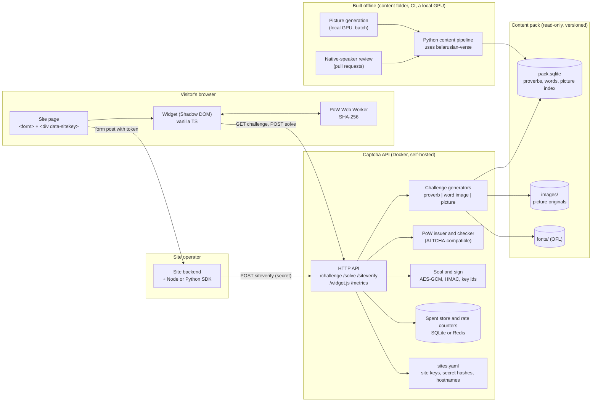
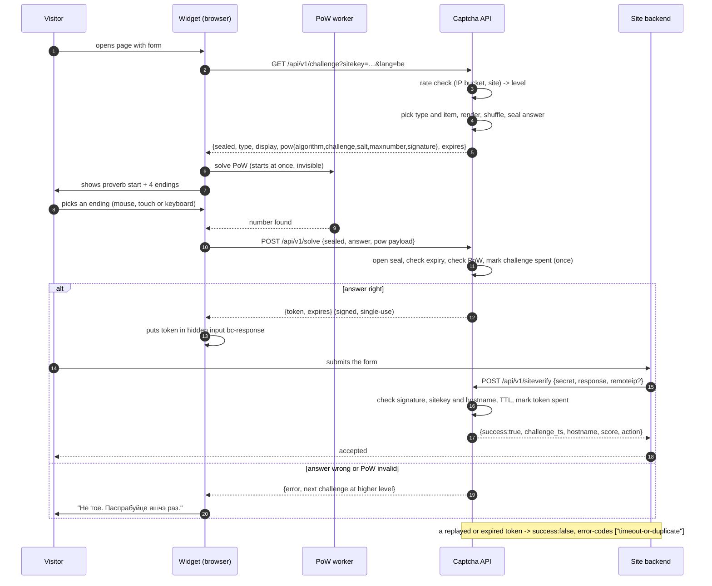
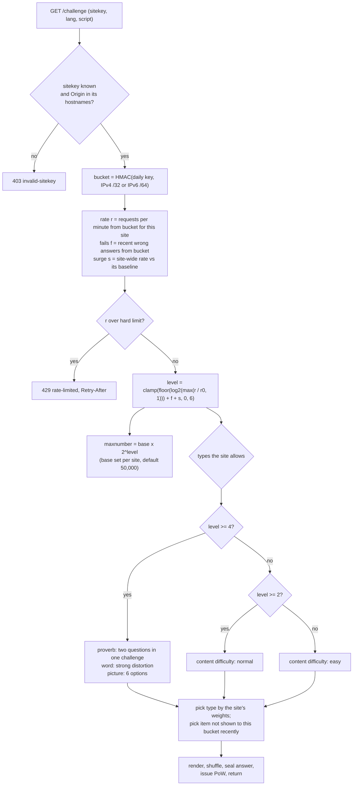
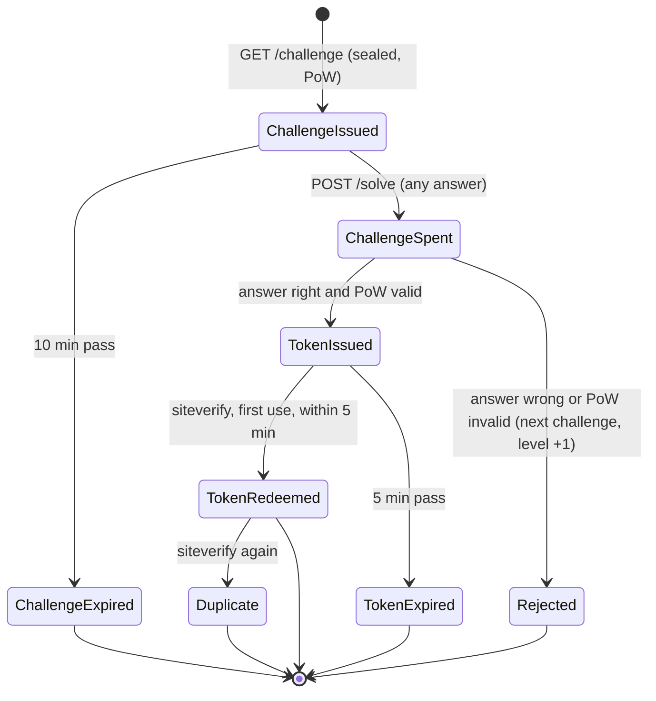

# belarusian-captcha: a self-hosted CAPTCHA in Belarusian, backed by proof-of-work

**Date:** 20 November 2026
**Owner's request:** "a good captcha library with Belarusian words and phrases which can be used by different web sites"

**Decisions already made by the owner:** three challenge types (finish the proverb, type the distorted
word, word to picture), each paired with an invisible proof-of-work (PoW); delivery as a drop-in JS
widget, a self-hosted verify API in Docker, and server SDKs for Node and Python with a
siteverify-style call; a public Apache-2.0 repository. Audio was not chosen; an accessibility
fallback is still designed here and left to the owner as decision D3.

**How this was made.** Read the README, NOTICE, SECURITY and CI of the owner's `belarusian-verse`
(GrammarDB data and its licence) and `belarusian-tts` (voice and model licences); read the
documentation and licences of ALTCHA, Friendly Captcha and mCaptcha; checked that the names
`belarusian-captcha` are free on GitHub, npm and PyPI. A local LLM was asked to draft sample
proverb items with distractors; its draft was unusable (section 3.4 says why, and that result
shaped the distractor design). Every proverb in this document is a **draft that needs
native-speaker review** before it enters a content pack. No code exists yet.

Evidence is marked **[doc]** (read in a project's own documentation or code), **[web]** (a
third-party page), **[measured]** (run for this design) or **[unverified]** (an estimate to be
measured in phase 1 or by the benchmark).

---

## 0. Summary

**The problem.** Belarusian web sites that want a CAPTCHA today send their visitors' data to a
US cloud (reCAPTCHA, hCaptcha, Turnstile) and show them English or Russian. There is no CAPTCHA
that speaks Belarusian, and no self-hosted one with Belarusian content.

**What this is, honestly.** A CAPTCHA that is pleasant for a Belarusian speaker, private (no
third-party calls, no cookies, no fingerprinting) and that makes automated abuse **cost** something.
It is **not** proof of humanity. A modern multimodal LLM reads distorted Cyrillic and probably
knows the common proverbs; a CAPTCHA farm solves anything. The language challenge filters cheap
bots and makes the site feel like home; the proof-of-work and the rate limits carry the security
weight; the score is one signal among the site's own.

**The design in five parts:**

1. **Challenges and content** (section 3): proverbs from public-domain folklore collections, words
   from the Belarusian Grammar Database, pictures generated offline; a Python content pipeline
   builds a versioned content pack with a native-speaker review step; answers are normalised
   (ў/у, і/и, apostrophes, stress marks, case, Cyrillic or Łacinka).
2. **Proof-of-work and tokens** (section 4): an ALTCHA-compatible SHA-256 PoW whose difficulty
   rises with the request rate per IP bucket and per site; sealed (encrypted and authenticated)
   stateless challenges; signed, single-use, short-lived pass tokens; a spent-token store
   (SQLite, or Redis for several replicas).
3. **The verify API** (section 5): TypeScript on Node in one Docker image; endpoints `challenge`,
   `solve`, `siteverify` (reCAPTCHA-shaped, so existing plugins work by changing a URL); site keys
   and secret keys; Prometheus metrics; minimal, IP-free logs.
4. **The widget and the SDKs** (section 6): a vanilla TypeScript widget in Shadow DOM
   (`<script>` plus `<div data-sitekey>`), be / be-Latn / ru / en, light and dark,
   keyboard and screen-reader support; Node and Python SDKs of a few dozen lines each.
5. **Proof that it works** (section 8): unit tests, a Playwright end-to-end test, and a
   **bot-resistance benchmark** that runs an OCR engine and a local multimodal model against the
   challenges and reports solve rates next to human success rates, as the release gate.

**Total size:** about **23 working days** of engineering without the audio fallback, **26** with it (section 9), plus
native-speaker review time for the content, which is people's time and not engineering. The MVP
(proverb plus PoW plus widget plus both SDKs plus Docker) is about **10 days**.

---

## 1. Threat model

### 1.1 Who attacks, and what they want

| Attacker | Example | Cost they will pay |
|---|---|---|
| Spam script | a form-filler posting comments, no JavaScript | almost none |
| Headless browser | Playwright or Puppeteer running the page | a CPU-second or so per attempt |
| OCR pipeline | Tesseract with the `bel` model, or a document-OCR model | cheap, local |
| Multimodal LLM | a vision-language model that reads Cyrillic and knows Slavic proverbs | cents per thousand, or free on a local GPU |
| CAPTCHA-solving farm | people paid per solve, reached through a solving API | about a tenth of a cent to a few cents per solve **[web, typical market prices, unverified]** |
| Replay / token theft | re-sending a captured token, or using a token solved on another site | none, if the token allows it |

### 1.2 What each challenge stops, and what it does not

| Challenge | Stops | Does not stop |
|---|---|---|
| **Finish the proverb** (pick 1 of 4 endings) | scripts that cannot run JavaScript; bots without Belarusian; people who do not read Belarusian (that is a cost, see D9) | **a blind guess wins 25 %** of the time; an LLM that knows the proverb (likely for pan-Slavic ones such as «Адна ластаўка вясны не робіць»); a bot that scraped the pool; farms |
| **Type the distorted word** | scripts; generic OCR at strong distortion | **multimodal LLMs, which read distorted text well**; a trained OCR model; farms |
| **Word to picture** (pick 1 of 4–6) | scripts; image-hash lookup if perturbation is strong | **CLIP-style image-text models, which solve this almost perfectly** **[unverified, the benchmark will measure]**; blind guessing (17–25 %); farms |
| **Proof-of-work** (always, invisible) | mass attempts from one machine: each attempt costs CPU time; floods from one IP bucket: difficulty climbs | a patient attacker at low rate; an attacker with a GPU and native SHA-256 code (orders of magnitude faster than a browser) unless the PoW is memory-hard; farms, which pay the PoW in the victim's browser |
| **Signed single-use token, short TTL** | replay; using a token on another site; tokens harvested now and used tomorrow | a relay attack inside the TTL (a farm solves on behalf of a bot and hands the token back) |
| **Rate limits** | floods, enumeration of the content pool | distributed bots with many IPs |

**Conclusion, said plainly:** against a determined attacker with a modern multimodal model, none of
the three language challenges is a barrier. What the design gives a site is: (1) a cost per
attempt that grows with abuse, (2) no replay, (3) a filter for the cheap bulk spam that is most of
the abuse on small sites, (4) a Belarusian, private experience for real visitors. The README and
the widget's documentation must say this in the same words. The bot-resistance benchmark
(section 8.3) publishes the solve rates so the claim is measured, not marketed.

### 1.3 The defences, layer by layer

1. **Answers never reach the client.** The browser sees the prompt and shuffled options with
   per-render random ids. The correct answer is only inside the sealed challenge (AES-256-GCM,
   server key), which the browser cannot open.
2. **PoW on every attempt**, solved in a Web Worker while the visitor reads the challenge, so a
   human does not notice it and a bot pays it per try. Difficulty adapts (section 4.2).
3. **One answer per challenge.** A wrong answer spends the challenge; the next one comes with a
   higher PoW and, at higher levels, two questions (blind-guess rate 1/16).
4. **Pass tokens** are signed, bound to the site key and the hostname, single-use at
   `siteverify`, and expire in **5 minutes** (D7). Sealed challenges expire in **10 minutes**.
5. **Rate limits** per IP bucket (IPv4 /32, IPv6 /64), per site key, and per secret key at
   `siteverify`.
6. **A score from 0 to 1** in the `siteverify` answer, from: PoW level reached, number of failed
   attempts, time to answer (a correct answer in under ~0.8 s is unlikely from a human), and
   challenge type. The site decides what to do with it; the documentation calls it defence in
   depth and never "probability of human".

### 1.4 What it deliberately does not do

No device fingerprinting, no cookies, no cross-site tracking, no behavioural telemetry (mouse
paths). These are the signals hCaptcha and Turnstile rely on; leaving them out is the privacy
selling point and also the reason the design is weaker than theirs against advanced bots. A site
that needs more adds its own signals (account age, honeypot fields, moderation).

### 1.5 Comparison with existing CAPTCHAs: what to borrow

| Project | Licence | Model | What to borrow | What not |
|---|---|---|---|---|
| **ALTCHA** | MIT **[web, repository]** | self-hosted PoW; HMAC-signed challenges; widget; optional code-from-image with audio in its paid Sentinel | **its PoW protocol, wire-compatible** (D2): `{algorithm, challenge, maxnumber, salt, signature}`, answered with a base64 JSON payload; its `expires` parameter in the salt; its server libraries can verify our PoW part. Its MIT licence permits using `altcha-lib` as a dependency | its widget (we need our own UI for language challenges); its newer v2/v3 key-derivation formats only later (phase 3) |
| **Friendly Captcha** | open-source SDK under MPL-2.0, sources differ on older packages **[web, conflicting]** | PoW of many small puzzles, difficulty scaled by request rate; hosted service | the idea of **difficulty that rises with the rate seen from a source**, and of several small puzzles for smoother progress on slow phones | no code: its verification is a hosted service |
| **mCaptcha** | AGPL-3.0 server **[web]** | self-hosted PoW with rate-based difficulty "levels" | the concept of **levels keyed to traffic** | **no code**: AGPL would bind this Apache-2.0 project |
| **hCaptcha / Turnstile** | proprietary, cloud | image tasks or invisible risk scoring with fingerprinting | **the `siteverify` request and response shape** (secret, response, remoteip → success, challenge_ts, hostname, error-codes), so existing CMS plugins and server code work by changing a URL; the invisible-by-default idea | the third-party calls and fingerprinting |

---

## 2. Architecture

### 2.1 Components



**Trust zones.** The browser is untrusted. The site backend holds the secret key and talks to the
captcha API server-to-server. The captcha API holds the sealing key and the site secrets' hashes.
The content pack is public data (it ships in a public image); its secrecy is **not** a defence.

### 2.2 The full flow



### 2.3 Repository layout

One product, one repository. The SDKs live here because they version with the API protocol;
nothing here merges an existing repository.

```
belarusian-captcha/
  widget/            vanilla TypeScript widget, esbuild bundle -> dist/widget.js (+ worker)
  server/            TypeScript API (Fastify), sites.example.yaml
  Dockerfile         server image; at the root because the build needs the root lockfile and shared/
  shared/            protocol types, normaliser, PoW code shared by widget and server
  sdk/node/          npm package: verify(token, {secret, url})
  sdk/python/        PyPI package: verify(token, secret=..., url=...) - stdlib only
  content/           Python pipeline (pyproject), item sources (YAML), review records
  content/items/     proverbs.yaml, words.yaml, pictures.yaml - CC BY-SA 4.0 (see NOTICE)
  bench/             bot-resistance benchmark (Python), results/*.md
  demo/              static demo page and a tiny demo backend for Node and Python
  tests/fixtures/    normalisation and protocol fixtures shared by TS and Python tests
  docs/              DESIGN.md, PROTOCOL.md, INTEGRATION.md, THREAT-MODEL.md, architecture/
  .github/workflows/ ci.yml, release.yml, bench.yml (manual)
  LICENSE NOTICE SECURITY.md CONTRIBUTING.md CODE_OF_CONDUCT.md README.md
```

### 2.4 Tech choices

| Piece | Choice | Why |
|---|---|---|
| API language | **TypeScript on Node 24 LTS** (D1) | the widget must be TypeScript anyway, so the protocol types, the normaliser and the PoW code are one implementation used on both sides; ALTCHA's MIT `altcha-lib` is TypeScript; Node's built-in `crypto` covers AES-GCM, HMAC and SHA-256; one small image for sites that are mostly PHP or Node hosts |
| Content pipeline | **Python** | it runs offline, and the owner's Belarusian tools are Python: `belarusian-verse` gives stress, GrammarDB forms, frequency and spelling checks; the pipeline's output is a plain SQLite file the Node server reads |
| HTTP framework | Fastify | JSON-schema validation of every request, mature, fast; no framework in the widget |
| Image rendering | `@napi-rs/canvas` (prebuilt Skia, no system libraries) | renders the distorted word and perturbs pictures in-process with no ImageMagick or native build step |
| Fonts | OFL-licensed fonts with full Cyrillic and Łacinka coverage (ł, ć, č, š, ž, ŭ, ń, ś, ź) | free to ship in a public image |
| Stores | SQLite (`better-sqlite3`) by default; Redis as an option | one container, zero services for a small site; Redis for several replicas |
| Widget build | esbuild, IIFE bundle plus ES module | small, no runtime dependencies; under 25 kB gzipped plus the worker, checked in CI (5.7 kB when first built **[measured]**) |
| Python SDK | standard library only (`urllib`, `json`) | nothing to audit, works in any framework |
| Container | **distroless** Node 24 (`gcr.io/distroless/nodejs24-debian13:nonroot`) pinned by digest, uid 65532, no shell or npm, read-only root filesystem, one writable volume for SQLite (decided in #6) | small attack surface |

---

## 3. Challenges and content

### 3.1 Sources and licences

| Content | Source | Licence | Notes |
|---|---|---|---|
| Proverbs and set phrases | **I. I. Nasovich, collection of Belarusian proverbs and sayings (1874)** | public domain (author died 1877) **[unverified: the edition and its scan to be confirmed]** | thousands of items **[unverified count]**; pre-reform spelling, so each item is transcribed into modern Belarusian orthography, which is itself a review step |
| | **M. Federowski, «Lud białoruski»**, the volumes of proverbs (early 20th century) | public domain (author died 1923) **[unverified which volume]** | written in Polish-based Latin script, so also transcribed |
| | Belarusian Wiktionary and Wikiquote proverb pages | CC BY-SA 4.0 **[web, project licence]** | attribution per item; keeps the pack share-alike |
| | new items written or chosen by contributors | CC BY-SA 4.0 under the contributor terms | folk proverbs are not anyone's copyright, but **a modern compilation's selection and commentary are**: items are never copied from a modern edited collection, even when the proverb itself is folk |
| Words (distorted word, word to picture) | **Belarusian Grammar Database (GrammarDB)**, by Aleś Bułojčyk and Uładzimir Koščanka, through the tables `belarusian-verse` publishes | **CC BY-SA 4.0** **[doc, belarusian-verse README and NOTICE]** | lemma, stress, part of speech; frequency from the same tables (Wikipedia-based, so it leans encyclopaedic: the pipeline filters place names and proper nouns) |
| Pictures | generated offline on a local GPU with an open-weights image model, one prompt per concept, many variants | the model's licence must allow it (D10); outputs published under CC0 or CC BY-SA 4.0 | image-model licences differ (some Apache-2.0, some non-commercial); to be confirmed before phase 4 |
| | alternative or seed set: **OpenMoji** | CC BY-SA 4.0 **[web]** | icon sets are the easiest thing for an image model to recognise; useful for the demo, weak as a defence |
| Audio fallback (if D3 chooses it) | `belarusian-tts`: OmniVoice (Apache-2.0) cloning a FLEURS reference voice (CC-BY-4.0) **[doc, belarusian-tts README]** | the audio inherits FLEURS attribution | pre-rendered offline, never at request time |

**The licence split, like `belarusian-verse`:** the **code is Apache-2.0**; the **content pack is
CC BY-SA 4.0** (forced by GrammarDB and Wiktionary, and fine for the rest), published as its own
release asset and listed in `NOTICE`. A site that only runs the image redistributes the pack
unmodified with its attribution; the widget shows a small "content: CC BY-SA" link in its info
panel.

### 3.2 Script: Cyrillic and Łacinka

- Items are stored **in Cyrillic** (modern official orthography, 2008 rules) as the canonical form.
- Łacinka is **generated** by a deterministic transliterator in `shared/` (classical Łacinka:
  `ł`/`l` before vowels, `ć`, `ś`, `ź`, `ŭ`, `j` for iotation). Its output is reviewed per item in
  the same pull request as the item, because proverbs contain the edge cases (soft signs,
  apostrophes, `шч`).
- A site picks the script (`data-script="cyrl" | "latn"`, default Cyrillic, D8). A typed answer is
  accepted **in either script**: the normaliser transliterates Łacinka input to Cyrillic before
  comparing.
- Taraškievica (classical orthography) is out of scope for the content; answers typed in it are
  accepted only where folding makes them equal (D8).

### 3.3 Normalising answers (typed word challenge)

The visitor may type on a Russian, Ukrainian, Polish or English keyboard. The normaliser runs on the
server only, and the same table drives the content pipeline's checks (shared fixtures in
`tests/fixtures/normalise.json`, used by the TS and Python tests).

| Step | Rule | Example |
|---|---|---|
| 1 | Unicode NFC; trim; collapse spaces | |
| 2 | remove stress marks: U+0301 combining acute, U+0300 grave | `мо́ва` → `мова` |
| 3 | lower case with the `be` locale | `МОВА` → `мова` |
| 4 | fold apostrophes `'` U+0027, `’` U+2019, `ʼ` U+02BC, `‘` U+2018, `` ` `` U+0060, `ʹ` U+02B9, and Russian `ъ` → one apostrophe | `сям’я`, `сямʼя`, `сямъя` → `сям'я` |
| 5 | fold `ў` → `у` | a keyboard without `ў` |
| 6 | fold Russian `и` → `і`, `щ` → `шч` | Russian keyboard |
| 7 | fold Latin look-alikes to Cyrillic (`a e i o p c x y`) | mixed-script typing |
| 8 | Łacinka input → Cyrillic by the transliterator, then steps 2–7 | `mova` → `мова` |
| 9 | `ё` → `е` **only** for comparison | Russian habit of writing `е` |

The pipeline rejects any word whose folded form equals the folded form of a different word **in
the same challenge set** (it does not matter for a single typed word, but it matters for picture
labels and keeps the rule simple). Folding makes the challenge easier for bots too; that is
accepted, because the typed-word challenge is a usability feature first.

### 3.4 Proverb items and distractors

**An item** is a proverb or set phrase with a cut point, an id, a source, a difficulty and review
records:

```yaml
- id: pr-0001
  text: "Не кажы гоп, пакуль не пераскочыш."
  cut: "Не кажы гоп,"            # what the visitor sees
  ending: "пакуль не пераскочыш"  # the right answer
  source: { work: "…", page: "…", licence: "public-domain" }
  difficulty: easy                 # easy | normal | hard
  tags: [everyday]
  review: [ { reviewer: "<handle>", verdict: ok, date: 2026-… } ]
  status: draft                    # draft -> reviewed -> live -> retired
```

**Draft examples** (written for this document, **not reviewed**; every one needs a native
speaker's check of wording, spelling and whether it is the common form):

| Start shown | Right ending | Distractors (endings of other items) |
|---|---|---|
| Не кажы гоп, | пакуль не пераскочыш | тое і пажнеш · вясны не робіць · далей будзеш |
| Што пасееш, | тое і пажнеш | пакуль не пераскочыш · вочы вялікія · не таварыш |
| Цішэй едзеш — | далей будзеш | вясны не робіць · тое і пажнеш · вочы вялікія |
| Адна ластаўка | вясны не робіць | далей будзеш · не таварыш · пакуль не пераскочыш |
| У страху | вочы вялікія | тое і пажнеш · далей будзеш · вясны не робіць |

**Distractors are endings of other reviewed items**, not free text. The local-LLM experiment for
this design showed why **[measured]**: asked for eight Belarusian proverbs with three plausible
wrong endings each, the model returned Russian proverbs translated word for word, a non-word
(«напеўчыцца»), and "wrong" endings that were synonyms of the right one («не лавіць» against «не
злавіць»), so two answers were correct at once. A generated distractor can be right, and a
CAPTCHA with two right answers fails real people.

Rules for choosing distractors per render:

1. Draw 3 endings from other `live` items of a **similar shape** (same number of words ±1, same
   grammatical start where the pipeline can tell from GrammarDB tags), so a bot cannot pick the
   only ending that fits grammatically.
2. **Never** an ending from a proverb whose start is a near variant of this one (the pipeline groups
   variants by normalised overlap; variants share a `family` id).
3. An ambiguity screen in the pipeline: a pair (start, distractor) that a judge model rates as a
   plausible real saying is flagged, and **a native speaker decides**. The model may flag; it never
   approves.
4. Options are shuffled per render, carry random ids, and the cut point may move by one word where
   the item lists alternatives, so the visible pair (start, options) varies.

**Review step.** Every item enters as `draft` in a pull request. It goes `live` only after
**two native speakers** approve it (D5), recorded in `review:` with a handle, not a name. A reviewer
checks: real and common, modern spelling right, the ending unambiguous among the drafted distractor
pool, nothing offensive. A `retired` item stays in the file so ids never change meaning.

### 3.5 What is kept out

The pipeline and the review exclude:

- **ethnic, national and religious slurs and stereotypes**: old collections, Nasovich's included,
  contain proverbs about Jews, Poles, Roma and other neighbours that are offensive today; they are
  never used, and the pipeline's stop-list flags their keywords for the reviewer;
- **politics**: state symbols, current events, war, names of politicians and parties, in either
  direction; the project must stay usable by any Belarusian site;
- obscenity, violence, cruelty to animals, misogyny (common in old family proverbs);
- religion: mild folk phrases that mention God are common («Хто рана ўстае, таму Бог дае»);
  whether to allow them is D6;
- proper nouns and place names in the word lists (from GrammarDB tags), and words with a second
  offensive meaning (stop-list plus review).

### 3.6 Difficulty levels

| Level | Proverb | Typed word | Picture |
|---|---|---|---|
| easy | well-known items, 3 options | 4–6 letters, common (top 5,000 by frequency), mild distortion | 4 options, common nouns |
| normal | 4 options | 5–8 letters, top 20,000, medium distortion | 4 options |
| hard | 4 options, less common items, **two questions** in one challenge | 7–10 letters, strong distortion, decoy strokes | 6 options |

Content difficulty rises with the level (section 4.2), but more slowly than the PoW: making the
language harder hurts people more than it hurts a model.

### 3.7 Pool size and memorisation

A bot that scrapes the demo can collect the whole pool, so the pool's secrecy is not a defence.
What the pool size does:

- **Proverbs**: target **300 reviewed items for the MVP, 1,000+ later** (each needs two reviews,
  so this is the content bottleneck). With 3 distractors drawn from a few hundred endings and
  movable cut points, a lookup table needs the start → ending map, which is small; it takes
  a scraper hours. The design accepts this and relies on PoW per attempt and rate limits.
- **Words**: tens of thousands of eligible lemmas and forms from GrammarDB; every image is rendered
  fresh, so there is nothing to memorise but the word list, which is public anyway.
- **Pictures**: 300+ concepts × 8–16 generated variants × per-render perturbation.
- **Rotation**: the pack carries `live` flags; a site can set `pack.retire_after` to retire a
  share of items each release; the content pack is versioned (`2027.01`) and sites update by
  pulling a new image or mounting a new pack.

### 3.8 The distorted-word renderer

Per render, with fresh randomness from the server's CSPRNG: a font from the pool, per-glyph
rotation, scale and baseline jitter, a sine warp, 1–3 crossing strokes, background noise, slight
blur, PNG output as a data URI. The renderer avoids glyph pairs that become indistinguishable when
distorted (`і`/`l`, `ш`/`щ` are folded anyway, `н`/`и` at strong warp), and the bench measures human
success per preset so a preset that hurts people is dropped. **Honest note:** strong distortion
hurts people with low vision and dyslexia first, and vision-language models last.

### 3.9 Word to picture: images and anti-memorisation

- **Origin**: concepts are common, concrete, culturally neutral nouns (`яблык`, `кот`, `лодка`,
  `парасон`) from the word list. Each concept gets 8–16 images generated offline in a batch on a
  local GPU (prompt template plus seed list in `content/pictures.yaml`, so the set is
  reproducible), filtered by a person (wrong object, artefacts, anything unpleasant).
- **Per-render perturbation**: random crop and scale (±10 %), rotation (±8°), mirror, hue and
  contrast shift, noise, re-encode as JPEG at random quality, served as a data URI with a random
  name. This defeats exact-hash and most simple perceptual-hash lookup. It does **not** defeat an
  image-text model, which simply recognises the apple; the benchmark reports that rate.
- Options are 4 (or 6 at hard) pictures; the prompt is the word, and in `be-Latn` mode the Łacinka
  form.

---

## 4. Proof-of-work and tokens

### 4.1 The PoW protocol (ALTCHA-compatible)

ALTCHA's classic SHA-256 scheme **[doc, ALTCHA server libraries]**:

- the server picks a random `salt` (with `?expires=<unix>` and its own parameters inside it) and a
  secret random `number` in `[0, maxnumber]`; `challenge = hex(SHA-256(salt + number))`;
  `signature = hex(HMAC-SHA-256(key, challenge))`;
- the client searches `number` from 0 until the hash matches, and returns
  `base64(JSON{algorithm, challenge, number, salt, signature, took})`;
- the server checks the signature, the hash and the expiry.

Being wire-compatible (D2) means a site can use ALTCHA's own widget as a **PoW-only** fallback,
and any ALTCHA server library can check our PoW part. ALTCHA's library does not prevent replay by
itself **[doc, `verifySolution` checks signature, solution and expiry]**; here the PoW is bound to
the sealed challenge (the PoW `salt` carries the challenge id), and the challenge id is spent once.

**What a PoW costs, honestly.** The expected work is `maxnumber / 2` hashes. A browser computes
very roughly 1–5 million SHA-256 per second on a desktop and a few times fewer on a phone
**[unverified, measured in phase 1]**; a GPU with native code computes billions **[unverified]**.
SHA-256 PoW therefore mostly taxes **headless-browser** bots and floods from few machines; it is
weak against a GPU attacker. Phase 3 adds a memory-hard option (scrypt or Argon2id, as ALTCHA's
newer formats do) to narrow that gap, at the cost of slower phones (D2).

### 4.2 Choosing the challenge and the difficulty



Defaults (all per site in `sites.yaml`): `r0 = 10` requests per minute, hard limit 120 per
minute, base 50,000 (a fraction of a second on a phone **[unverified]**), level 6 = 3.2 million
(several seconds on a phone, the ceiling a person tolerates). The rate and failure counters live
in memory or Redis for 10 minutes; the bucket key is an HMAC with a key that rotates daily, so no
IP address is stored or logged.

### 4.3 Sealed challenges, pass tokens, and the spent store

- **Sealed challenge** (stateless): `AES-256-GCM(key[kid], {cid, sitekey, type, answer_hash,
  level, issued, expires, bucket})`. Unsolved challenges cost no storage, so a flood of challenge
  requests cannot fill a database.
- **Solve** spends the `cid` with `INSERT … ON CONFLICT DO NOTHING` (SQLite) or `SET NX EX`
  (Redis); a second use fails. One answer per challenge.
- **Pass token**: `base64url(payload) . HMAC-SHA-256(key[kid], payload)`, payload
  `{tid, sitekey, hostname, action, score, iat, exp}`. Signed, not encrypted: it holds nothing
  secret, and the site may read it.
- **siteverify** checks the secret key against the site's stored hash (SHA-256 of a 32-byte
  random secret; constant-time compare), the signature, `sitekey`, `exp`, and spends `tid` once.
- **Keys**: the sealing and signing keys come from a file or environment variable, never from the
  image; each carries a `kid` so two keys can be active during a rotation.
- **Clock**: only the server's clock is used for every time check.



Spent ids are kept until their expiry plus a minute, then pruned (SQLite: a periodic `DELETE`;
Redis: the key's TTL). At 100 solves a minute that is a few thousand rows.

---

## 5. The verify API

### 5.1 Endpoints

| Method and path | Caller | Request | Response |
|---|---|---|---|
| `GET /api/v1/challenge` | widget | `sitekey`, `lang` (`be`, `be-Latn`, `ru`, `en`: UI only), `script` (`cyrl`, `latn`), `types` (optional subset) | `{sealed, type, display, pow, expires}`; `display` is `{prompt, options:[{id,text}]}`, `{image, inputmode}` or `{word, options:[{id,image}]}` |
| `POST /api/v1/solve` | widget | `{sealed, answer, pow}` (`answer` is an option id, two ids, or text) | `200 {token, expires}` or `422 {error, next}` with a new challenge |
| `POST /api/v1/siteverify` | site backend | form or JSON `{secret, response, remoteip?, sitekey?, action?}` (`action`, if sent, must equal the token's) | `{success, challenge_ts, hostname, score, action, "error-codes": []}` (reCAPTCHA-shaped) |
| `GET /api/v1/fallback` | widget | `sitekey` | the accessible alternative (section 6.3), once D3 is decided |
| `GET /widget.js`, `/widget.worker.js` | browser | | the widget, with `Cache-Control` and published SRI hashes |
| `GET /healthz` | operator | | `{ok, pack_version, store}` |
| `GET /metrics` | operator, bound to a separate port | | Prometheus text |

Errors use stable codes: `invalid-sitekey`, `invalid-secret`, `invalid-input-response`,
`timeout-or-duplicate`, `hostname-mismatch`, `rate-limited`, `bad-pow`, `wrong-answer`,
`action-mismatch` (siteverify only).

**CORS**: `challenge` and `solve` answer only the origins listed for the site key; `siteverify`
sends no CORS headers (server-to-server only).

### 5.2 Configuration

`sites.yaml` (mounted read-only), plus environment variables for keys and the store:

```yaml
sites:
  - sitekey: bc_pk_3f9a…           # public, goes in the page
    secret_sha256: "…"             # hash of the secret; the secret is shown once at creation
    hostnames: [example.by, www.example.by]
    types: { proverb: 1, word: 1, picture: 0 }   # weights
    script: cyrl
    pow: { base: 50000, max_level: 6 }
    rate: { r0_per_min: 10, hard_per_min: 120 }
    token_ttl_s: 300
```

```
BC_KEYS_FILE=/run/secrets/bc-keys.json   # {"active":"k2","keys":{"k1":"…","k2":"…"}}
BC_STORE=sqlite:/data/bc.sqlite          # or redis://redis:6379/0
BC_PACK=/etc/bc/pack.json                # mounted; no pack is built into the image until a reviewed pack exists
BC_METRICS_HOST=0.0.0.0                  # the image's default, so /metrics is reachable; publish 9464 only internally
BC_LOG_LEVEL=info
```

A CLI in the image manages sites without editing hashes by hand:
`bc-admin site add --host example.by` prints the site key and **the secret once**, and writes the
hash; `bc-admin keys rotate` adds a new key id and keeps the old one for one TTL. `site add` and
`keys rotate` support `--dry-run`, which prints the change to the YAML without writing it.

### 5.3 Docker

```
docker run -d --read-only --cap-drop ALL --security-opt no-new-privileges \
  -p 8080:8080 -p 127.0.0.1:9464:9464 \
  -v ./sites.yaml:/etc/bc/sites.yaml:ro \
  -v ./bc-keys.json:/run/secrets/bc-keys.json:ro \
  -v ./pack.json:/etc/bc/pack.json:ro \
  -v bc-data:/data \
  ghcr.io/yauhenbichel/belarusian-captcha-server:<version>
```

The image is `belarusian-captcha-server` (the npm and PyPI SDKs keep the name
`belarusian-captcha`), for linux/amd64 and linux/arm64. Non-root (uid 65532, so mounted files must
be readable by it), read-only root filesystem, one writable volume, `HEALTHCHECK` on `/healthz`.
Sites, keys and the content pack are mounted, never built in. The README's "Run with Docker"
section is the operational reference.
Memory about 100–150 MB **[unverified]**, no GPU. A `compose.yaml` example adds Redis for
several replicas.

### 5.4 Privacy and logging

- No calls to any third party, from the browser or the server. No cookies, no `localStorage`.
- The widget sends only what a challenge needs; no user agent parsing, no fingerprint.
- **Logs** carry the time, endpoint, site key, result code, level and duration. **No IP address,
  no user agent, no answer text.** The rate bucket is an HMAC under a key that rotates every day
  and is never written to disk, so counters cannot be linked across days.
- This lets a site say in its privacy notice that the CAPTCHA processes the IP address only
  transiently, in memory, for abuse prevention, and stores no personal data: a strong GDPR
  position, and the main reason to choose this over a cloud CAPTCHA. (The site's own counsel
  decides the legal wording; the project documents the facts.)

### 5.5 How it is seen working

Prometheus metrics: `bc_challenges_total{site,type,level}`, `bc_solves_total{site,type,result}`,
`bc_siteverify_total{site,result}`, `bc_rate_limited_total{site}`, `bc_pow_level` histogram,
`bc_solve_seconds` histogram (time to answer), `bc_render_seconds` histogram. A sudden rise in
`level` or in `wrong-answer` on one site is an attack in progress; `timeout-or-duplicate` at
`siteverify` is replay or a slow form. The demo page shows these counters live.

---

## 6. The widget and the SDKs

### 6.1 Embedding

```html
<script src="https://captcha.example.by/widget.js" async defer
        integrity="sha384-…" crossorigin="anonymous"></script>
<form method="post" action="/comment">
  <div class="belarusian-captcha" data-sitekey="bc_pk_3f9a…"
       data-lang="be" data-script="cyrl" data-theme="auto"></div>
  <button>Адправіць</button>
</form>
```

The widget adds a hidden input `bc-response` to the enclosing form. Options:
`data-callback`, `data-expired-callback`, `data-error-callback`, `data-action`, `data-types`,
`data-api` (the API origin if it differs from the script's). A JS API mirrors them
(`belarusianCaptcha.render(el, opts)`, `.reset()`, `.getResponse()`), and an ES module export
lets bundlers import it.

### 6.2 What it does

- **Shadow DOM** so the site's CSS cannot break it and it cannot break the site's.
- **Content Security Policy**: no `eval`, no inline scripts; styles through constructable
  stylesheets; no `blob:` workers. A worker script must be same-origin with the page, so the
  worker runs off the main thread only when `widget.worker.js` is served from the site's origin
  (or `data-worker` names a same-origin copy); when the widget comes from the API's origin, or the
  worker cannot load, the same search runs on the main thread in yielding slices (found while
  building the widget; see `widget/README.md`).
- **i18n of the interface**: `be` (default), `be-Latn`, `ru`, `en`. Only the interface changes;
  the challenge stays Belarusian. Strings live in `widget/src/i18n/*.json`, reviewed by native
  speakers like content.
- **Themes**: light, dark, `auto` from `prefers-color-scheme`; respects `prefers-reduced-motion`
  (no spinner animation) and `forced-colors`.
- **Keyboard**: options are a `radiogroup` (arrow keys move, Space or Enter picks), the text field
  submits on Enter, focus never jumps on load (no auto-focus unless the site asks).
- **Screen readers**: a labelled `group` with the prompt as its accessible name; status changes
  ("Правяраем…", "Гатова", "Не тое, вось новае пытанне") in an `aria-live="polite"` region; the
  word image carries no alt text with the answer (that would give it away) but a link to the
  accessible alternative.
- **Size**: under 25 kB gzipped plus the worker, checked in CI; 5.7 kB gzipped and a 0.5 kB worker
  when first built **[measured]**.
- **Failure display**: if the API is unreachable, the widget says so in the visitor's language
  and calls `data-error-callback`; the SDK decides fail-open or fail-closed (D11).

### 6.3 Accessibility: a non-visual alternative (D3)

All three challenges are visual. WCAG 2.2 success criterion 1.1.1 requires a non-text CAPTCHA to
offer an alternative in another sense, or another way through. Options, for the owner:

| Option | How | Cost | Against bots |
|---|---|---|---|
| **A. Audio word** | a word or short phrase spoken by the `belarusian-tts` voice, **pre-rendered offline** (TTS is too slow for request time on a CPU); per-request perturbation: background noise, speed ±10 %, random silence; the visitor types what they hear | a few days; the audio pool: 2,000 clips ≈ 100 MB **[unverified]** | weak: Belarusian ASR (the owner's own `belarusian-asr`, or Whisper) transcribes it; same honesty as section 1 |
| **B. PoW-only pass with a lower score** | "I cannot do this challenge" link: a higher-level PoW alone earns a token with `score ≤ 0.3` and `fallback: true` in `siteverify` | small, in phase 1 | the site sees the low score and may add its own check; PoW still costs |
| **C. Text question, screen-reader friendly** | the proverb challenge is already text; read by a screen reader it works as is, so blind visitors can use it; only the typed-word and picture types need A or B | none: proverb challenges are always offered as the alternative | as the proverb |

**Recommendation:** B and C in the MVP (the proverb is accessible text, and B is the exit for
anyone the language or the task excludes, including people who do not read Belarusian), A as
phase 6 if the owner wants a spoken option.

### 6.4 SDKs

Node (`belarusian-captcha` on npm, also exporting the widget for bundlers):

```ts
import { verify } from "belarusian-captcha/server";
const r = await verify(req.body["bc-response"], {
  secret: process.env.BC_SECRET!, url: "https://captcha.example.by", remoteip: req.ip,
  minScore: 0.5, failOpen: false,
});
if (!r.success) return res.status(400).send("captcha");
```

Python (`belarusian-captcha` on PyPI, standard library only):

```python
from belarusian_captcha import verify
r = verify(token, secret=os.environ["BC_SECRET"], url="https://captcha.example.by",
           min_score=0.5, fail_open=False, timeout=3.0)
if not r.success: abort(400)
```

Both return `{success, score, hostname, action, challenge_ts, error_codes}`, time out in 3 s by
default, never log the secret, and have framework examples in `demo/` (Express, Fastify, Django,
Flask, FastAPI). Because the API is reCAPTCHA-shaped, PHP and CMS plugins work by changing the
verify URL; `docs/INTEGRATION.md` shows WordPress and plain PHP.

---

## 7. Security of the project itself

- `SECURITY.md`: private reporting through GitHub's "Report a vulnerability", what counts (a
  token accepted twice, an answer recoverable from the client, a seal broken, a bypass of rate
  limits, an injection through content), and that a bot solving a challenge is **expected and
  documented**, not a vulnerability, unless it beats a published benchmark number by a wide margin.
- No secrets in the repository: CI uses OIDC trusted publishing for npm and PyPI and
  `GITHUB_TOKEN` with `packages: write` for the image; no stored tokens.
- Dependencies pinned with lock files; actions pinned by full commit SHA; Dependabot for actions,
  npm and pip; the image pinned by digest and scanned in CI.
- Content is data, never markup: options and prompts are set with `textContent`, images as data
  URIs generated by the server.

---

## 8. Testing

### 8.1 Unit and protocol tests

- `shared/`: normaliser (the fixture table in section 3.3), Łacinka transliterator (round trips on
  the whole proverb pool), PoW issue and check (including ALTCHA's own test vectors for
  compatibility), seal and token code (tampering, wrong `kid`, expiry, replay).
- `server/`: every endpoint, every error code, rate-limit levels, the spent store under
  concurrent solves (two simultaneous solves of one challenge: exactly one wins).
- `content/`: the pipeline refuses an item without source, licence or two reviews; flags
  stop-list words; rejects a distractor from the same `family`.
- SDKs: against a recorded fake API and against the real container in CI.

### 8.2 End to end

Playwright against the demo page and the container: load, PoW completes, answer by mouse and by
keyboard only, token reaches the demo backend, `siteverify` accepts once and refuses a replay;
light and dark; the four UI languages; an axe-core accessibility scan with zero violations; a
Firefox, Chromium and WebKit matrix.

### 8.3 The bot-resistance benchmark (the acceptance metric)

`bench/` runs solvers against a running API and reports, per challenge type and level, the share
of challenges each solver passes within one attempt:

| Solver | Against |
|---|---|
| random guess | proverb, picture (the floor: 25 %, 17–25 %) |
| lookup table built by scraping N challenges | proverb, picture |
| Tesseract with the `bel` model | typed word |
| a document-OCR model, run locally | typed word |
| a local vision-language model (Qwen-VL class), asked in Belarusian | typed word, picture, proverb (as an image of the text) |
| a local text LLM (gpt-oss class) | proverb |
| a CLIP-style model | picture |

The benchmark talks to any OpenAI-compatible endpoint given by environment variables, so it holds
no host names; the owner runs it on the home GPU server, and its results are committed as
`bench/results/<date>.md` with the model names and versions.

Each release reports **two numbers per type**: native-speaker success rate (from a small panel,
D12) and best bot solve rate. Proposed gates (D12): a distortion preset ships only if humans pass
it at ≥ 90 % and Tesseract at ≤ 5 %; every result is published whatever it is, including the
expected high VLM rates. The release notes never claim a type is "bot-proof".

### 8.4 CI

`ci.yml` on every push and pull request: lint and type-check, unit tests (Node 24, Python 3.11–3.13),
content pipeline checks, build the widget and check its size budget, build the image, Playwright,
`docker scout`- or Trivy-style image scan. All actions pinned by SHA, `permissions: contents: read`
by default. `release.yml` runs when a `v*.*.*` tag is pushed: it checks the tag is semver, smoke-tests the
amd64 image, pushes amd64 and arm64 images with provenance and an SBOM (`:latest` only for
non-pre-release tags), then creates the GitHub release. GitHub creates the GHCR package as
private; it is made public by hand after the first release. Not done yet: the image scan and the
Playwright run (both later in phase 1); CI builds amd64 only.
`bench.yml` is manual and only documents how to run the benchmark; it does not run models in CI.

### 8.5 Demo page

`demo/` is a static page with all three types side by side, the four UI languages, both themes,
a "show what the server sees" panel (sealed blob, PoW level, the `siteverify` answer) and the
live metrics; it runs from `docker compose up` with a demo site key. A public demo is optional
(D4).

---

## 9. Phases

| Phase | What | Done when | Size |
|---|---|---|---|
| 0. Repository | this design merged (SECURITY.md and CONTRIBUTING.md come with it); CODE_OF_CONDUCT.md, NOTICE; CI skeleton with pinned actions; Dependabot | CI green on an empty build; the design PR merged by the owner | 0.5 d |
| 1. MVP: proverb + PoW | `shared/` (PoW ALTCHA-compatible, seal, tokens, normaliser); `server/` (challenge, solve, siteverify, SQLite, rate levels, metrics, `bc-admin`); widget (proverb, invisible PoW, i18n, themes, keyboard, screen reader, fallback B); Node and Python SDKs; Docker image; demo; content pipeline with **300 reviewed proverbs**; Playwright; bench for proverbs (guess, lookup, text LLM) | a fresh `docker compose up` protects the demo form end to end; replay refused; axe clean; bench report committed; npm, PyPI and GHCR 0.1.0 published | 10 d (+ review time) |
| 2. Distorted word | renderer with presets; word list from GrammarDB through `belarusian-verse` tables; Łacinka input; bench with Tesseract, OCR model, VLM | presets that meet the human and Tesseract gates ship; VLM rate published | 4 d |
| 3. Hardening | Redis store; key rotation drill; memory-hard PoW option; per-site tuning guide; Łacinka content mode; load test (challenges per second per core) | 2 replicas behind a proxy pass e2e; documented limits | 3 d |
| 4. Word to picture | concept list; batch generation on a local GPU; human filter; perturbation; bench with CLIP-style model | 300 concepts × 8 variants live; bench published | 4 d (+ one night of GPU) |
| 5. Integrations | WordPress plugin or PHP snippet, framework examples, `INTEGRATION.md`, public docs site | a WordPress test site verified through the plugin | 1.5 d |
| 6. Audio fallback (only if D3 = A) | pre-rendered TTS clips, perturbation, typed answer, bench with an ASR model | screen-reader e2e passes the audio path | 3 d |

**Total:** 23 d without phase 6, 26 d with it. The
critical path outside engineering is native-speaker review: 300 items at two reviews each is
roughly 10–15 hours of reviewers' time **[unverified]**.

---

## 10. What it costs

| Resource | Cost |
|---|---|
| Runtime per instance | one container, ~100–150 MB RAM, no GPU, < 1 CPU core at hundreds of challenges a minute **[unverified, measured in phase 3]**; the word renderer is the heaviest call (tens of ms per image **[unverified]**) |
| Disk | image ~150–250 MB with fonts and the pack; pictures add ~100–200 MB (300 × 16 × ~40 kB); audio ~100 MB; SQLite a few MB |
| GPU (offline only) | picture generation: one batch of ~5,000 images, a few hours on the home GPU server **[unverified]**; the bench: a VLM and an OCR model for an hour or so per release. One model fits the GPU at a time, so these batches evict the resident model and run at night |
| Money | none: no paid services; npm, PyPI, GHCR and GitHub Actions free for public repositories |
| People | native-speaker reviewers (D5); a small usability panel (D12) |

**Running an instance on the home GPU server for other sites (D4).** The browser calls the API
directly, so a shared instance must be reachable from the public internet. That would be the
first public inbound service on the home server: it changes its trust zone and exposure, and
needs an architecture review of the home-server estate first. The design does not depend on it:
each site can run its own container, and a small VPS can host a shared one.

---

## 11. Risks and how it fails

| Risk or failure | What happens | Mitigation |
|---|---|---|
| API down or unreachable | the widget shows "Капча недаступная" and calls the error callback; the form cannot get a token | SDK `failOpen` per site (D11); `HEALTHCHECK`; restart policy; the site's own fallback (moderation queue) |
| Store unavailable (SQLite locked, Redis down) | `solve` and `siteverify` fail closed with `503`: no token is accepted twice because the store could not be checked | alert on `bc_siteverify_total{result="error"}`; Redis optional, SQLite in WAL mode |
| Content pack missing or corrupt | the server refuses to start | pack checksum and version checked at start |
| Key leaked | anyone can mint tokens | keys outside the image; `bc-admin keys rotate` with two-key overlap; documented incident steps |
| A VLM solves everything | the language layer is no barrier | expected and published; the PoW and rate limits remain; the site adds its own signals |
| Farms | humans solve for bots | cost per solve only; nothing in this design stops a farm, and the docs say so |
| Ambiguous or wrong item | real visitors fail | two reviews per item; a "report this question" link in the widget that sends only the item id; `wrong-answer` rate per item in metrics, so an item that people fail is retired |
| Offensive item slips through | reputational harm, a site removes the widget | stop-list, two reviews, the report link, fast retire through a pack update |
| People who do not read Belarusian are blocked | real visitors on a Belarusian site who read only Russian or English | fallback B; `ru`/`en` UI explains the exit; the site chooses types (D9) |
| PoW too slow on old phones | visitors wait seconds | `max_level` per site; level falls back as the rate drops; the bench measures time on a low-end phone profile |
| Licence slip in content | takedown | every item carries source and licence; the pipeline refuses items without them; no modern compilations |

---

## 12. The owner's decisions

| # | Decision | Recommendation |
|---|---|---|
| D1 | Language of the API | **TypeScript on Node 24**: one implementation of protocol, PoW and normaliser for widget and server; Python stays where the Belarusian tools are, in the offline content pipeline and the Python SDK |
| D2 | PoW format | **ALTCHA classic SHA-256, wire-compatible** for the MVP (interoperable, MIT, simple); a memory-hard option (scrypt or Argon2id) in phase 3, opt-in per site |
| D3 | Accessibility fallback | **B (PoW-only pass with low score) and C (proverb as accessible text) in the MVP**; A (pre-rendered `belarusian-tts` audio) as phase 6 only if wanted, knowing ASR defeats it |
| D4 | Shared instance on the home GPU server | **Not in the plan**; each site runs its own container or a small VPS hosts one. If wanted, an architecture review of exposing the home server first |
| D5 | Native-speaker review | **two reviewers per item**, recorded by handle; who the first reviewers are |
| D6 | Religious folk phrases («…таму Бог дае») | allow mild folk phrases, exclude anything polemical; ethnic and political items always excluded |
| D7 | Token and challenge lifetimes | token 5 min, challenge 10 min, one answer per challenge |
| D8 | Script default and Taraškievica | Cyrillic, 2008 orthography by default; Łacinka per site; Taraškievica not in content |
| D9 | Who the challenge is for | Belarusian readers, with fallback B always on so non-readers are never locked out |
| D10 | Picture source | images generated offline with an open-weights model whose licence permits it (to be confirmed before phase 4), published CC0; OpenMoji only for the demo |
| D11 | SDK default when the API is down | **fail closed**, configurable per site |
| D12 | Release gates and human panel | humans ≥ 90 %, Tesseract ≤ 5 % per typed-word preset; all bot rates published; a panel of 10–20 native speakers per release with a new type |
| D13 | Content licence | **CC BY-SA 4.0 for the content pack**, Apache-2.0 for code, as in `belarusian-verse` |
| D14 | Package names | `belarusian-captcha` on npm and PyPI (both free on 20 November 2026 **[measured]**) and `ghcr.io/yauhenbichel/belarusian-captcha-server` (image renamed in #6) |

---

## 13. Sources

- ALTCHA, repository and licence (MIT), widget options, algorithms and accessibility claims:
  https://github.com/altcha-org/altcha **[web]**
- ALTCHA server library `altcha-lib` README (createChallenge, verifySolution, expires, params,
  MIT): https://app.unpkg.com/altcha-lib@1.3.0/files/README.md **[web]**
- Friendly Captcha on open source (SDK licence): https://friendlycaptcha.com/for-open-source and
  https://friendlycaptcha.com/insights/open-source-captcha/ **[web]**
- mCaptcha, licence and model: https://european-alternatives.eu/product/mcaptcha **[web]**
- Overview of open-source CAPTCHAs in 2026: https://trycap.dev/guide/open-source-captcha **[web]**
- Belarusian Grammar Database: https://github.com/Belarus/GrammarDB and its tables as published by
  `belarusian-verse`: https://huggingface.co/datasets/YauhenBichel/belarusian-verse (CC BY-SA 4.0)
  **[doc]**
- `belarusian-verse` README and NOTICE (sources, licences, stress and frequency tables) **[doc]**
- `belarusian-tts` README (OmniVoice Apache-2.0, FLEURS CC-BY-4.0 reference voice) **[doc]**
- WCAG 2.2, success criterion 1.1.1 Non-text Content (CAPTCHA exception requires an alternative):
  https://www.w3.org/TR/WCAG22/#non-text-content **[web]**
- reCAPTCHA `siteverify` request and response shape:
  https://developers.google.com/recaptcha/docs/verify **[web]**
- OpenMoji (CC BY-SA 4.0): https://openmoji.org **[web]**
